  

<pre>
<b>josh@github:~$ cat about.txt</b>
Software engineer into ML and full-stack development.
I like hard problems and building things properly, end to end.

<b>josh@github:~$ ls ~/projects</b>
<a href="https://github.com/joshbeira/Agentic-Trading-Benchmark-PDT-Hackathon-">pdtbench</a>           benchmark for AI trading agents (hackathon winner)  <a href="https://pdtbench.onrender.com">[demo]</a>
<a href="https://github.com/joshbeira/byte-the-evidence-sol2">byte-the-evidence</a>  multi-agent AI negotiation trainer
<a href="https://github.com/joshbeira/commonroom">commonroom</a>         full-stack shared-expense app                       <a href="https://commonroom-ledger.onrender.com">[live]</a>
<a href="https://github.com/joshbeira/Penny">penny</a>              accessible letter reader for web and mobile         <a href="https://joshbeira.github.io/Penny/">[live]</a>
<a href="https://github.com/joshbeira/cineindex">cineindex</a>          film search and analytics engine                    <a href="https://cineindex.onrender.com">[live]</a>
<a href="https://github.com/joshbeira/matrixpong">matrixpong</a>         embedded C arcade game                              <a href="https://joshbeira.github.io/matrixpong/">[live]</a>

<b>josh@github:~$ cat stack.yml</b>
languages: [Python, TypeScript, Java, C, SQL]
ml/ai:     [PyTorch, TensorFlow, OpenCV, LLM agents]
web:       [React, Flask, FastAPI]
infra:     [Linux, Docker, GitHub Actions]

<b>josh@github:~$ cat contact.txt</b>
web       <a href="https://joshbeira.com">joshbeira.com</a>
linkedin  <a href="https://www.linkedin.com/in/josh-beira">linkedin.com/in/josh-beira</a>
email     <a href="mailto:joshbeira@gmail.com">joshbeira@gmail.com</a>

<b>josh@github:~$</b> █
</pre>
